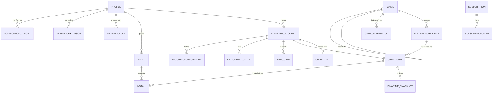

# Data Model: Multi-Account Game Library

**Feature**: [spec.md](./spec.md) | **Plan**: [plan.md](./plan.md) | **Date**: 2026-10-15

Storage is one SQLite database (research D3). Identifiers are UUIDv7 stored as text unless stated otherwise;
timestamps are UTC RFC 3339; durations are whole minutes. "Platform" values are stable string keys from the
platform registry compiled into the binary (for example `steam`, `epic`, `gog`, `xbox`, `battlenet`, `ubisoft`,
`ea`, `amazon`, `itch`, `humble`, `riot`, `tempo`, `manual`).

## Overview



## Identity and access

### Profile

A person using the instance (FR-031).

| Field | Type | Rules |
|---|---|---|
| id | uuid | |
| username | text | unique, 3-32 chars `[a-z0-9._-]` |
| display_name | text | 1-64 chars |
| email | text, nullable | unique when set; used only for trusted-proxy mapping |
| password_hash | text | Argon2id PHC string |
| role | enum `admin`, `member` | at least one active admin must remain |
| locale | enum `en`, `fr`, `auto` | default `auto` |
| disabled_at | timestamp, nullable | disabled profiles cannot sign in |
| created_at, updated_at | timestamp | |

Admins manage profiles but read other libraries only through sharing (clarification 2026-10-15).

### Session

Rows of the custom `tower-sessions` store (research D4): `id` (opaque), `profile_id`, `data` (blob),
`expires_at`. Expired rows are purged hourly.

### Preference

`profile_id`, `key`, `value` (JSON). Stores last view, sort and filters (FR-015). Primary key
(`profile_id`, `key`).

## Platforms and accounts

### Platform account

One account on one platform, belonging to exactly one profile (FR-001).

| Field | Type | Rules |
|---|---|---|
| id | uuid | |
| profile_id | uuid | FK Profile, cascade delete |
| platform | text | registry key |
| external_account_id | text | the platform's stable account id (SteamID64, Epic account id, ...); for `manual` accounts a generated id |
| label | text | editable, defaults to `display_name` |
| display_name | text, nullable | as reported by the platform |
| status | enum | see state machine below |
| sync_enabled | bool | default true |
| schedule | text, nullable | cron override; null = instance default |
| subscription_hint | JSON, nullable | subscriptions the player declares for this account |
| last_sync_at, last_success_at | timestamp, nullable | |
| created_at, updated_at | timestamp | |

Unique (`platform`, `external_account_id`) across the instance: a second connection of the same account is
refused and names the holding profile (spec edge cases).

State machine:

```text
pending --validate ok--> active
active --auth error / credential expired--> needs_reconnect
active --repeated non-auth failures (3 runs)--> degraded
degraded --successful run--> active
needs_reconnect --new credential validated--> active
any --player disables--> disabled --player enables--> active
```

### Credential

The secret used to read one account (FR-041, research D5).

| Field | Type | Rules |
|---|---|---|
| id | uuid | |
| account_id | uuid | FK Platform account, unique, cascade delete |
| kind | enum `api_key`, `oauth`, `session_cookie`, `token` | |
| sealed | blob | XChaCha20-Poly1305 ciphertext of a JSON payload (key, refresh token, cookie...) |
| nonce | blob | 24 bytes |
| key_id | text | identifies the operator key used |
| expires_at | timestamp, nullable | refresh-token or cookie expiry when known |
| refreshed_at | timestamp, nullable | last successful refresh |
| created_at | timestamp | |

Never returned to the web layer; only the connector runtime unseals it. `expires_at` within 7 days raises the
reconnect call to action (FR-023).

## Catalog and ownership

### Game

The canonical game a player recognizes (FR-007).

| Field | Type | Rules |
|---|---|---|
| id | uuid | |
| title | text | display title |
| sort_title | text | title without leading article, used for sorting |
| search_key | text | normalized title (research D7) |
| release_year | int, nullable | |
| kind | enum `game`, `dlc`, `tool` | tools (benchmarks, SDKs) are hidden by default |
| parent_game_id | uuid, nullable | set for DLC (FR-010) |
| description | text, nullable | |
| cover_asset_id, hero_asset_id, logo_asset_id | uuid, nullable | FK Asset |
| metadata_source | text, nullable | `igdb`, `wikidata`, `platform`, `manual` |
| created_at, updated_at | timestamp | |

### Game external id

`game_id`, `source` (`igdb`, `wikidata`, `steam`, `gog`, `epic`, `xbox`, `itch`, ...), `external_id`. Unique
(`source`, `external_id`). Used by matching (FR-008).

### Platform product

What a platform sells or lists, before grouping into a game.

| Field | Type | Rules |
|---|---|---|
| id | uuid | |
| platform | text | |
| platform_game_id | text | Steam appid, Epic namespace:catalogItemId, GOG product id, Xbox title id, ... |
| title | text | as reported |
| kind | enum `game`, `dlc`, `bundle`, `tool`, `unknown` | |
| parent_platform_game_id | text, nullable | base product for DLC when the platform says so |
| game_id | uuid, nullable | FK Game; null until matched |
| edition | text, nullable | "Deluxe", "Game of the Year", ... |
| platform_artwork | JSON, nullable | URLs offered by the platform |
| raw | JSON | trimmed platform payload, for re-matching |
| updated_at | timestamp | |

Unique (`platform`, `platform_game_id`).

### Ownership

The fact that one account has access to one product (FR-006). This is the provenance record of Principle II.

| Field | Type | Rules |
|---|---|---|
| id | uuid | |
| account_id | uuid | FK Platform account, cascade delete |
| product_id | uuid | FK Platform product |
| acquisition | enum `purchase`, `free_claim`, `subscription`, `free_to_play`, `family_shared`, `manual` | |
| first_seen_at | timestamp | |
| last_seen_at | timestamp | updated by every complete listing that contains it |
| unavailable_since | timestamp, nullable | set when a complete listing no longer contains it (FR-025) |
| playtime_minutes | int, nullable | null = not provided by the platform |
| last_played_at | timestamp, nullable | |
| achievements_unlocked, achievements_total | int, nullable | |
| source | enum `connector`, `agent`, `manual`, `import` | |
| note | text, nullable | player note |

Unique (`account_id`, `product_id`). An ownership becomes available again (clears `unavailable_since`) when it
reappears.

Lifecycle:

```text
(new in listing) --> available --absent from a complete listing--> unavailable
unavailable --present again--> available
any --account deleted--> removed (row deleted with the account)
```

### Playtime snapshot

`ownership_id`, `day` (date), `playtime_minutes`. Primary key (`ownership_id`, `day`). Written once per day per
ownership when the value changed (FR-018).

### Install

`id`, `agent_id` (FK Agent), `platform`, `platform_game_id`, `account_external_id` (nullable), `install_path`
(stored only on the instance, never exported), `size_bytes` (nullable), `last_seen_at`. Unique (`agent_id`,
`platform`, `platform_game_id`). Joined to ownerships by platform, product and account.

### Enrichment value

Per-account data points (FR-017).

| Field | Type | Rules |
|---|---|---|
| id | uuid | |
| account_id | uuid | FK Platform account |
| game_id | uuid, nullable | null for platform-level values (for example a Steam level) |
| provider | text | `steam`, `riot`, `gw2`, `osrs`, `wow`, ... |
| key | text | `platform_level`, `rank`, `character:<name>:level`, ... |
| value | JSON | number, string or small object |
| unit | text, nullable | |
| refreshed_at | timestamp | |

Unique (`account_id`, `game_id`, `provider`, `key`).

### Subscription

`id`, `provider` (`gamepass_pc`, `gamepass_ultimate`, `ea_play`, `ubisoft_plus`, ...), `name`, `catalog_synced_at`.

`subscription_item`: `subscription_id`, `platform`, `platform_game_id`, `added_at`, `removed_at`.

`account_subscription`: `account_id`, `subscription_id`, `origin` (`detected`, `declared`), `active`.

A title counts as owned if any ownership with another acquisition exists for the same game (spec US8).

### Match decision

`id`, `kind` (`merge`, `split`), `product_id` (the product moved), `target_game_id` (nullable for split to a new
game), `created_by` (profile), `created_at`. Applied after automatic matching on every run (FR-009).

### Asset

`id`, `sha256` (unique), `mime`, `width`, `height`, `variant` (`original`, `grid`, `thumb`), `source`
(`igdb`, `steamgriddb`, `platform`), `source_url`, `fetched_at`. Files live under `<data>/assets/<sha256>`.

### Tag

`tag`: `id`, `profile_id`, `name` (unique per profile). `game_tag`: `profile_id`, `game_id`, `tag_id`.

## Sharing

### Sharing rule

`owner_profile_id`, `audience_profile_id`, `created_at`. Primary key on both. No row means not shared (sharing is
off by default, FR-032).

### Sharing exclusion

| Field | Type | Rules |
|---|---|---|
| id | uuid | |
| owner_profile_id | uuid | |
| audience_profile_id | uuid, nullable | null = applies to every audience |
| kind | enum `game`, `platform`, `account` | |
| ref | text | game id, platform key or account id |

Visibility rule (research D8): a viewer sees an ownership if its account belongs to the viewer, or if the owner
has a sharing rule toward the viewer and no exclusion (global or for this viewer) matches the ownership's game,
platform or account. Excluded ownerships are removed before any aggregation, so counts and filters never reveal
them (SC-011).

## Agents

### Agent

| Field | Type | Rules |
|---|---|---|
| id | uuid | |
| profile_id | uuid | the profile that paired it |
| name | text | machine name chosen by the player |
| os | enum `windows`, `linux` | |
| version | text | |
| token_hash | text | SHA-256 of the bearer token |
| status | enum `active`, `paused`, `revoked` | |
| sources | JSON | enabled launcher sources and custom paths |
| schedule | text | cron, default every 6 hours |
| autostart | bool | reported by the agent |
| paired_at, last_seen_at | timestamp | |

### Pairing code

`code_hash`, `profile_id`, `expires_at` (10 minutes), `used_at`. Single use.

### Agent report

`id`, `agent_id`, `source` (launcher key), `content_hash`, `received_at`, `summary` (JSON counts). The payload is
applied immediately and not stored; only its hash is kept to skip identical reports.

## Operations

### Sync run

| Field | Type | Rules |
|---|---|---|
| id | uuid | |
| account_id | uuid, nullable | null for catalog jobs (subscriptions, metadata) |
| platform | text | |
| capability | enum `library`, `playtime`, `achievements`, `enrichment`, `catalog`, `metadata` | |
| trigger | enum `schedule`, `manual`, `agent`, `startup` | |
| status | enum `running`, `succeeded`, `partial`, `failed`, `skipped` | |
| complete_listing | bool | true only if the connector returned every page |
| added, removed, updated | int | |
| error_kind | text, nullable | `auth_expired`, `rate_limited`, `transient`, `permanent`, `parse` |
| error_message | text, nullable | redacted, at most 500 chars |
| started_at, finished_at | timestamp | |

Retention: 90 days (spec assumptions).

### Job

`id`, `kind`, `account_id` (nullable), `cron`, `next_run_at`, `locked_until`, `enabled`. The runner picks due jobs
with `locked_until` in the past.

### Activity event

`id`, `profile_id`, `kind` (`game_added`, `game_unavailable`, `account_needs_reconnect`, `account_degraded`,
`agent_silent`, `sync_failed`), `game_id` (nullable), `account_id` (nullable), `payload` (JSON), `created_at`,
`run_id` (nullable).

### Notification target

| Field | Type | Rules |
|---|---|---|
| id | uuid | |
| profile_id | uuid | |
| kind | enum `discord`, `ntfy`, `gotify` | in-app is implicit and always on |
| name | text | |
| sealed_config | blob | URL, topic and token, sealed like credentials |
| nonce, key_id | blob, text | |
| events | JSON array | subset of activity kinds |
| enabled | bool | |
| last_sent_at | timestamp, nullable | |
| last_error | text, nullable | redacted |

### Reminder ledger

`target_id`, `issue_key` (for example `reconnect:<account_id>`), `last_sent_on` (date). Guarantees at most one
reminder per issue per day (FR-035).

### Instance setting

`key`, `value` (JSON), `sealed` (bool). Holds the default schedule, time zone, metadata provider keys (sealed) and
trusted-proxy settings when set from the UI rather than the environment.
